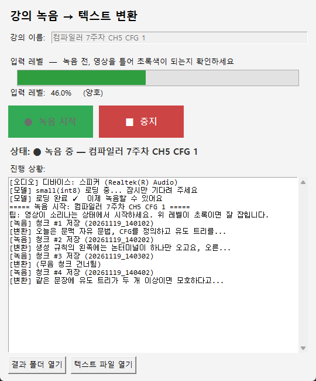
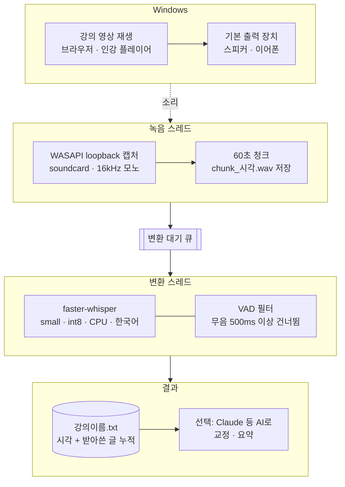

<div align="center">

# 🎙 wspr

**강의 영상을 틀어 두면, 받아쓴 스크립트가 강의별 텍스트 파일로 쌓입니다**

인강 · 유튜브처럼 내려받을 수 없는 스트리밍 강의의 소리를 그대로 잡아<br/>
1분마다 [faster-whisper](https://github.com/SYSTRAN/faster-whisper)로 받아 적어 강의 스크립트를 만드는 Windows 도구입니다.




<sub>녹음 중인 GUI. 입력 레벨 미터로 소리가 충분히 잡히는지 보고, 1분마다 청크가 저장 · 변환됩니다. 화면 속 강의 이름과 로그는 예시입니다.</sub>

</div>

<br/>

## 목차

1. [왜 만들었나](#-왜-만들었나)
2. [한눈에 보기](#-한눈에-보기)
3. [동작 구조](#-동작-구조)
4. [설계에서 고민한 점](#-설계에서-고민한-점)
5. [결과물 예시](#-결과물-예시)
6. [설치](#-설치)
7. [사용법](#-사용법)
8. [설정과 모델 고르기](#-설정과-모델-고르기)
9. [문제 해결](#-문제-해결)
10. [파일 구성](#-파일-구성)
11. [한계와 다음 단계](#-한계와-다음-단계)
12. [개발 과정](#-개발-과정)

<br/>

## 🤔 왜 만들었나

강의 영상의 **스크립트(받아쓴 글)** 를 만들려고 만들었습니다.

- 인강과 유튜브 강의는 다시 찾아보기 어렵습니다. "그 설명이 몇 분쯤이었지?"를 찾으려면 영상을 처음부터 다시 돌려야 합니다.
- 들으면서 받아 적으면 정작 내용을 놓칩니다.
- 스트리밍 강의는 영상 파일을 내려받을 수 없는 경우가 많아, 파일을 넣는 받아쓰기 도구를 쓸 수 없습니다.

그래서 **컴퓨터에서 재생되는 소리 자체**를 녹음해 받아 적기로 했습니다. 강의를 틀어 두기만 하면 강의별 텍스트 파일에 1분 단위로 스크립트가 쌓입니다. 원문은 거칠지만, Claude 같은 AI에 맡겨 오타 · 문맥을 교정하고 요약하면 강의노트를 보완하는 데 충분히 쓸 만합니다.

<br/>

## 🔭 한눈에 보기

| | |
|---|---|
| **입력** | Windows 기본 출력 장치로 나오는 모든 소리. 스피커든 블루투스 이어폰이든 상관없고, 가상 오디오 케이블이 필요 없습니다. |
| **처리** | 60초 청크(16kHz 모노 WAV) → faster-whisper `small` · `int8` · CPU, 한국어, 무음 구간 자동 건너뜀 |
| **출력** | `{강의이름}.txt`에 청크 시각과 함께 누적, 원본 오디오는 `audio/{강의이름}/`에 보관 |
| **실행 방법** | GUI(더블클릭) · CLI · Claude Code에 "시작 / 끝"이라고 말하기 |
| **환경** | Windows 10/11, Python 3.10+, GPU 없이 CPU만으로 동작 |
| **규모** | Python 3개 파일 약 520줄 (GUI 330줄, CLI 150줄, 녹음 테스트 45줄) |

<br/>

## 🏗 동작 구조

녹음과 변환을 **서로 다른 스레드**로 나누고 큐로 잇습니다. 변환이 잠깐 밀려도 녹음은 끊기지 않습니다.



**끝낼 때**: 녹음은 바로 멈추고, 큐에 남은 청크는 **모두 변환한 뒤** 끝납니다. 마지막 몇 분이 사라지지 않습니다.

<br/>

## 🛠 설계에서 고민한 점

| 문제 | 결정 |
|---|---|
| 스트리밍 강의는 영상 파일이 없음 | 재생 중인 소리를 **WASAPI loopback**으로 직접 캡처합니다. 가상 오디오 케이블 같은 별도 설치 없이 기본 출력 장치를 그대로 씁니다. |
| 받아쓰기가 녹음보다 느릴 수 있음 | 녹음 · 변환 스레드를 나누고 **큐**로 연결했습니다. 변환이 밀려도 녹음은 계속되고, 끝낼 때 큐가 빌 때까지 기다립니다. |
| 청크를 얼마나 자를지 | **60초**로 정했습니다. 너무 짧으면 문장이 자주 잘리고 문맥이 없어 인식이 나빠지고, 너무 길면 결과가 늦게 나옵니다. GUI에서 중지하면 3초 이상 남은 소리도 마지막 청크로 저장합니다. |
| GPU 없는 노트북에서도 돌아야 함 | faster-whisper `small` 모델을 **int8**로 양자화해 CPU에서 돌립니다. 모델은 약 450MB이고 처음 실행할 때 한 번만 받습니다. |
| 쉬는 시간 · 무음 구간이 쓰레기 글이 됨 | **VAD 필터**(무음 500ms 이상)로 말소리 없는 구간을 건너뛰고, 글이 비면 파일에 쓰지 않습니다. |
| 볼륨이 작으면 인식 품질이 급격히 떨어짐 | GUI에 **입력 레벨 미터**(빨강 · 노랑 · 초록)를 넣어 녹음 전에 소리가 충분한지 확인하게 했습니다. 0.2초마다 갱신하고, 막대가 튀지 않게 천천히 내려오게 했습니다. |
| GUI가 멈추거나 꼬이지 않게 | 위젯은 **메인 스레드의 100ms 폴링에서만** 고칩니다. 스레드끼리는 큐 3개(오디오 · 로그 · 레벨)로만 주고받습니다. |
| AI 코딩 도구가 녹음을 켜고 끄게 | CLI는 스크립트 폴더에 **`STOP` 파일**이 생기면 끝납니다. 그래서 Claude Code에 "시작", "끝"이라고만 말해도 제어할 수 있습니다. |

<br/>

## 📄 결과물 예시

`컴파일러 7주차 CH5 CFG 1.txt` (예시)

```text
[20261119_140102]
오늘은 문맥 자유 문법, CFG를 정의하고 유도 트리를 그려 보겠습니다. 지난 시간에 본 정규 문법으로는 괄호 짝 맞추기를 표현할 수 없었죠.

[20261119_140202]
생성 규칙의 왼쪽에는 논터미널이 하나만 오고요, 오른쪽에는 터미널과 논터미널이 아무렇게나 섞여도 됩니다. 이게 문맥 자유라는 말의 뜻이에요.

[20261119_140402]
같은 문장에 유도 트리가 두 개 이상이면 모호하다고 합니다. 대표적인 예가 if-else 매달림 문제인데요.
```

- 대괄호 안은 그 청크를 저장한 시각(`연월일_시분초`)이라, 강의 영상의 대략 몇 분쯤인지 되짚을 수 있습니다.
- 무음 청크(위 예시의 14:03)는 건너뛰어 파일에 남지 않습니다.

<br/>

## ⚙ 설치

**1. Python과 ffmpeg**

```powershell
winget install Python.Python.3.12
winget install Gyan.FFmpeg
```

설치 후 **새 PowerShell 창**을 여세요(PATH 반영).

**2. 패키지**

```powershell
cd <이 저장소 경로>
py -m pip install -r requirements.txt
```

`small` 모델(약 450MB)은 처음 실행할 때 자동으로 받습니다. 미리 받아 두려면:

```powershell
py -c "from faster_whisper import WhisperModel; WhisperModel('small', device='cpu', compute_type='int8')"
```

<br/>

## ▶ 사용법

### 방법 A · GUI (가장 쉬움)

1. **`강의녹음.bat` 더블클릭** → 콘솔 창 없이 GUI가 뜨고, 잠시 뒤 "모델 로딩 완료"가 나옵니다.
2. 영상을 **소리 나게 재생**하고 입력 레벨이 **초록(양호)** 인지 확인합니다.
3. **강의 이름**을 넣고 **● 녹음 시작**.
4. 강의가 끝나면 **■ 중지** → **텍스트 파일 열기**로 결과를 봅니다.

결과는 스크립트 폴더의 `{강의이름}.txt`와 `audio/{강의이름}/`에 저장됩니다.

> [!WARNING]
> loopback 캡처는 **시스템 · 영상 볼륨의 영향을 받습니다.** 볼륨이 너무 낮으면 레벨이 빨강이 되고 인식 품질이 크게 떨어집니다. 헤드폰을 써도 잡히니, 볼륨만 0이 아니면 됩니다.

> [!TIP]
> 강의는 **1.5배속**으로 트는 것을 권합니다. 2배속 이상은 한국어 인식률이 눈에 띄게 떨어지지만, 1.5배속은 체감상 품질이 거의 같고 전체 시간이 줄어듭니다.

### 방법 B · CLI

```powershell
py transcribe_lecture.py --name "컴파일러 7주차 CH5 CFG 1"
```

다른 폴더에 저장하려면 `--out-dir`:

```powershell
py transcribe_lecture.py --name "컴파일러 7주차 CH5 CFG 1" --out-dir "D:\강의노트\컴파일러"
```

- 60초마다 청크 저장과 변환 로그가 출력됩니다.
- 끝내려면 `Ctrl+C`를 누르거나, 스크립트 폴더에 빈 `STOP` 파일을 만듭니다.

### 방법 C · Claude Code에서 말로 제어

Claude Code(VS Code 확장 등)를 열어 두고 이렇게 말합니다.

| 말 | Claude가 하는 일 |
|---|---|
| "CFG 1 강의 녹음 시작해 줘" | 백그라운드로 `transcribe_lecture.py --name "..."` 실행 |
| "끝" / "녹음 종료해 줘" | `STOP` 파일 생성 → 남은 청크까지 변환하고 안전하게 종료 |
| "이 txt 읽고 오타 · 문맥 교정해서 clean 파일로 저장해 줘" | 거친 원문을 문맥에 맞게 교정 |
| "이번 강의 핵심 5줄로 요약해 줘" | 강의 요약 |

### 먼저 장치 확인하기

녹음 장치가 제대로 잡히는지 10초만 녹음 · 변환해 볼 수 있습니다.

```powershell
py test_record.py
```

```text
[디바이스] 스피커(AirPods Pro)
[녹음] 10초 녹음 시작...
[볼륨] RMS=0.0814, Peak=0.5164
       (RMS < 0.001 이면 소리 거의 안 잡힘)
[변환] Whisper 돌리는 중...
감지 언어: ko (확률 1.00)
```

RMS가 0에 가까우면 Windows 기본 출력 장치를 확인하세요.

<br/>

## 🎛 설정과 모델 고르기

`transcribe_lecture.py`와 `lecture_gui.py` 맨 위 상수를 바꾸면 됩니다.

| 상수 | 기본값 | 설명 |
|---|---|---|
| `CHUNK_SECONDS` | 60 | 청크 저장 주기. 짧을수록 결과가 빨리 나오지만 문맥이 줄어듭니다 |
| `MODEL_SIZE` | `small` | `tiny` / `base` / `small` / `medium` / `large-v3` |
| `COMPUTE_TYPE` | `int8` | `int8` / `int8_float16` / `float16` / `float32` |
| `BEAM_SIZE` | 5 | 크면 정확도가 오르고 속도가 내려갑니다 (1\~5 권장) |

**모델별 대략 기준** (CPU)

| 모델 | RAM | 1분 오디오 변환 | 품질 |
|---|---|---|---|
| tiny | 약 150MB | 약 10초 | 낮음 |
| base | 약 300MB | 약 20초 | 보통 |
| **small** | **약 500MB** | **약 45초** | **좋음 (기본값)** |
| medium | 약 1.5GB | 약 2분 | 더 좋음 |

`small`은 1분 분량을 1분 안에 받아 적어서 강의 속도를 따라갑니다. `medium`은 더 정확하지만 1분 분량에 약 2분이 걸려 큐가 계속 쌓이므로, 끝난 뒤 남은 청크를 변환할 시간이 필요합니다.

<br/>

## 🩺 문제 해결

| 증상 | 확인할 것 |
|---|---|
| "ffmpeg를 찾을 수 없음" | ffmpeg 설치 후 PowerShell을 새로 열었는지 |
| 받아쓴 글이 계속 비어 있음 | `test_record.py`로 RMS 확인. 0에 가까우면 기본 출력 장치가 잘못 잡힌 것 |
| RAM이 부족해 느려짐 | `MODEL_SIZE = "base"`로 낮추기 |
| 터미널에서 한글이 깨져 보임 | 실제 `.txt`는 UTF-8로 정상 저장됩니다. 메모장 · VS Code로 열면 됩니다 |
| `강의녹음.bat`이 바로 꺼짐 | Python 런처(`pyw`)가 없는 설치입니다. 배치 파일의 `pyw`를 `pythonw.exe` 경로로 바꾸세요 |

<br/>

## 📁 파일 구성

```text
.
├── lecture_gui.py          GUI 버전 (입력 레벨 미터, 진행 로그, 결과 열기)
├── transcribe_lecture.py   CLI 버전 (--name, --out-dir, STOP 파일 종료)
├── test_record.py          10초 녹음 · 변환으로 장치와 볼륨 확인
├── 강의녹음.bat            GUI를 콘솔 창 없이 실행
├── requirements.txt        faster-whisper, soundcard, numpy, scipy
└── assets/gui.png          README 화면
```

녹음 파일(`audio/`, `*.wav`)과 받아쓴 결과(`*.txt`)는 `.gitignore`로 저장소에서 빼 두었습니다. 강의 내용에는 저작권이 있으니 결과물은 개인 학습용으로만 씁니다.

<br/>

## 🧭 한계와 다음 단계

**지금의 한계**
- **Windows 전용**입니다. WASAPI loopback에 의존합니다.
- **청크 경계에서 문장이 잘릴 수 있습니다.** 60초마다 끊기 때문에, 경계에 걸친 단어는 앞뒤 청크로 나뉘거나 일부가 빠질 수 있습니다.
- **화자를 구분하지 않습니다.** 질의응답이 섞인 강의는 누가 말했는지 알 수 없습니다.
- 원문은 전문 용어 · 고유명사를 자주 틀립니다. AI 교정을 거치는 것을 전제로 합니다.
- GUI는 결과를 스크립트 폴더에만 저장합니다(`--out-dir`은 CLI에만 있음).

**다음에 해 보고 싶은 것**
- 청크를 몇 초씩 겹쳐 잘라 경계 문장을 살리기
- 과목별 용어집을 모델 프롬프트로 넣어 고유명사 인식률 높이기
- 받아쓴 직후 AI 교정 · 요약까지 자동으로 이어 붙이기

<br/>

## 🗓 개발 과정

| 날짜 | 내용 |
|---|---|
| 2026-04-20 | CLI 버전: loopback 녹음 → 60초 청크 → faster-whisper 변환, STOP 파일 종료, `--out-dir` |
| 2026-05-31 | Tkinter GUI: 입력 레벨 미터, 진행 로그, 결과 폴더 · 파일 열기, 배치 파일 실행 |

<br/>

자유롭게 사용하세요.
